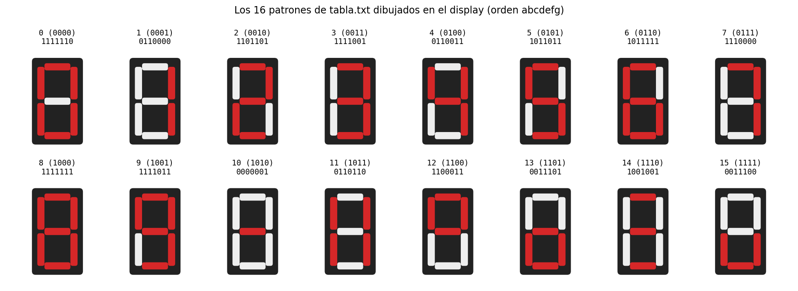
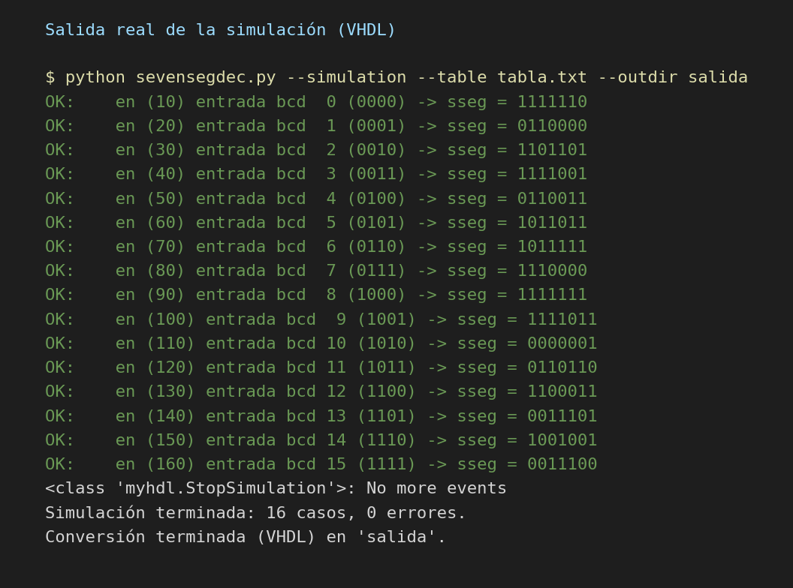
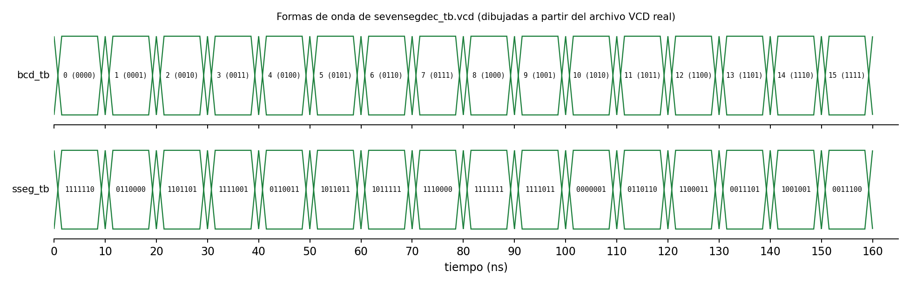
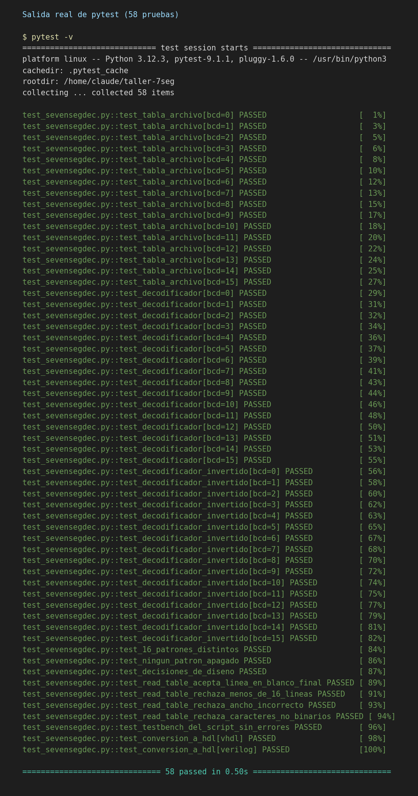

# Taller de segundo corte: decodificador de 7 segmentos

Sebastian Bejarano, Universidad de San Buenaventura.

Decodificador de 4 bits a 7 segmentos hecho como tabla de búsqueda (LUT) en MyHDL. El script simula el circuito, genera un archivo VCD y convierte el diseño a VHDL o Verilog. Las pruebas unitarias están en `test_sevensegdec.py` y usan pytest.

## Contenido del repositorio

| Archivo | Qué es |
|---|---|
| `tabla.txt` | Tabla de decodificación: 16 líneas, 7 bits por línea, orden `abcdefg` |
| `sevensegdec.py` | Script del curso con mis cambios (decodificador, testbench, conversión a HDL) |
| `test_sevensegdec.py` | Pruebas unitarias con pytest |
| `salida/sevensegdec_nexys.vhd`, `salida/pck_myhdl_011.vhd` | HDL generado en VHDL (el paquete `pck_myhdl_011.vhd` lo necesita el `.vhd` principal) |
| `salida/sevensegdec_nexys.v` | HDL generado en Verilog |
| `salida/sevensegdec_tb.vcd` | Formas de onda de la simulación |
| `docs/` | Capturas de la salida de la simulación, de pytest y del VCD |
| `requirements.txt` | Dependencias (`myhdl`, `pytest`) |

## 1. Diseño de los patrones

La tabla sigue la convención `a b c d e f g` (a es el bit de la izquierda):

| Entrada | Bits `abcdefg` | Figura |
|---|---|---|
| 0 | 1111110 | 0 |
| 1 | 0110000 | 1 (dibujado a la derecha, segmentos b y c) |
| 2 | 1101101 | 2 |
| 3 | 1111001 | 3 |
| 4 | 0110011 | 4 |
| 5 | 1011011 | 5 |
| 6 | 1011111 | 6 cerrado (enciende el segmento superior a) |
| 7 | 1110000 | 7 |
| 8 | 1111111 | 8 |
| 9 | 1111011 | 9 cerrado (enciende el segmento inferior d) |
| 10 | 0000001 | signo menos |
| 11 | 0110110 | dos barras verticales |
| 12 | 1100011 | cuadro superior |
| 13 | 0011101 | cuadro inferior |
| 14 | 1001001 | tres rayas horizontales |
| 15 | 0011100 | u minúscula |



Decisiones explícitas:

- **El 1** va a la derecha.
- **El 6 y el 9 son cerrados.** Con el 6 cerrado el segmento `a` queda encendido, y con el 9 cerrado queda encendido el `d`. Así no se confunden con una `b` o una `q` al verlos de lejos.
- **10 a 15:** no uso las letras A a F. Cada figura tiene una razón de ser, y ninguna repite un patrón de 0 a 9.
  - 10, signo menos: sirve para marcar un número negativo.
  - 11, dos barras verticales: se parece al símbolo de pausa.
  - 12, cuadro superior: valor alto o desbordamiento.
  - 13, cuadro inferior: valor bajo.
  - 14, tres rayas: estado de "procesando".
  - 15, u minúscula: se puede leer como "usuario" o "unidad".

## 2. Comandos

Dependencias:

```
pip install myhdl pytest
```

Simulación (genera el VCD) y conversión a VHDL, que es el lenguaje por defecto:

```
python sevensegdec.py --simulation --table tabla.txt --outdir salida
```

Conversión a Verilog:

```
python sevensegdec.py --table tabla.txt --verilog --outdir salida
```

Pruebas unitarias:

```
pytest -v
```

## 3. Resultados de la simulación



La línea `<class 'myhdl.StopSimulation'>: No more events` es el aviso normal de MyHDL cuando ya no quedan eventos por procesar. No es un error.

**Qué verifica el testbench.** Recorre las 16 entradas posibles (de 0000 a 1111), espera 10 ns después de cada una, lee la señal `sseg_tb` y la compara con la entrada correspondiente de la tabla. Si la lee distinta, imprime un `ERROR` con el valor esperado y el leído.

**Por qué no aparece ningún ERROR.** El decodificador y el testbench usan la misma tabla. Si la LUT está bien conectada y la entrada llega a la posición correcta, las dos cosas coinciden siempre. Por eso este chequeo comprueba la mecánica del circuito (indexación, conexión de señales, tiempos), pero no detecta una tabla mal diseñada o con un error de digitación. Para cubrir eso están las pruebas de pytest, donde los valores esperados están escritos aparte, a mano.

**Qué son los 7 bits de `seg`.** Cada bit controla un segmento del display, de izquierda a derecha: `a, b, c, d, e, f, g`. Un 1 enciende el segmento. Con 1111110 se encienden `a` a `f` y queda apagado `g`, que es el 0.

### Formas de onda (VCD)



El archivo `salida/sevensegdec_tb.vcd` se puede abrir en GTKWave o en https://vc.drom.io/. Esta figura la dibujé con matplotlib a partir de ese mismo VCD.

- `bcd_tb` (arriba) es la entrada. Cada 10 ns sube en uno: empieza en 0 y llega a 15 a los 150 ns. La simulación termina a los 160 ns.
- `sseg_tb` (abajo) es la salida. Cambia en el mismo instante que la entrada, sin retardo visible. Eso es lo esperado en lógica combinacional: no hay reloj ni registros, así que la salida depende solo de la entrada en ese momento.
- Cada valor de `sseg_tb` es el de la tabla: 1111110 para el 0, 0110000 para el 1, y así hasta 0011100 para el 15.

### HDL generado

- VHDL: [`salida/sevensegdec_nexys.vhd`](salida/sevensegdec_nexys.vhd) (con [`salida/pck_myhdl_011.vhd`](salida/pck_myhdl_011.vhd))
- Verilog: [`salida/sevensegdec_nexys.v`](salida/sevensegdec_nexys.v)

La tabla de Python se convierte en una instrucción `case` dentro de un proceso sensible a la entrada `bcd` (en Verilog, un `case` dentro de `always @(bcd)`). Cada línea de la tabla pasa a ser una rama: `when 0 => "1111110"`, `when 1 => "0110000"`, etc. Como la última rama, la del 15, cubre todo lo que queda, MyHDL la escribe como `when others`. No hay reloj ni flip-flops, así que es lógica puramente combinacional. En una FPGA, una herramienta de síntesis lo implementa con LUTs: cada bit de `sseg` es una función lógica de los 4 bits de entrada.

Además del `case`, el archivo generado tiene lo que agrega el módulo `sevensegdec_nexys`:

- Un proceso que invierte la salida cuando el puerto `invert` vale 1 (los segmentos de la Nexys4 DDR son activos en bajo, por eso existe esta opción).
- `bcdled`, que repite la entrada en los LEDs.
- `ssanodes`, fijo en 11111110, para que solo se encienda el primer display.

## 4. Pruebas unitarias

`test_sevensegdec.py` usa pytest y está separado del script, que solo tiene la lógica. Hay 58 pruebas:

- 16 casos parametrizados que comparan `tabla.txt` con los valores esperados escritos en el test.
- 16 casos parametrizados que simulan el decodificador en MyHDL y comparan la salida.
- 16 casos más con la salida invertida.
- Propiedades de la tabla: 16 patrones distintos, ninguno apagado, 1 a la derecha, 6 y 9 cerrados.
- Lectura de la tabla: se rechazan archivos con menos de 16 líneas, con ancho distinto de 7 o con caracteres que no son 0 ni 1.
- El testbench del script termina con cero errores.
- La conversión a VHDL y a Verilog genera los archivos con el `case` esperado.



Para comprobar que las pruebas detectan fallos, cambié a propósito una línea de la tabla en una copia temporal (apagué el segmento `g` del 6) y fallaron 3 pruebas, todas del caso 6: la de la tabla, la del decodificador y la del decodificador invertido.

## Cambios respecto al script del curso

- `read_table` valida el archivo y lanza un error claro. Antes, si algo fallaba, devolvía una tabla de ceros sin avisar.
- El testbench cuenta los errores y muestra el resultado de cada caso.
- Con `--invert`, el testbench original marcaba error en las 16 entradas porque comparaba la salida negada contra la tabla sin negar. Ya compara contra el valor negado.
- Se agregó `--outdir` para elegir dónde se guardan el VCD y el HDL, y `tabla.txt` es la tabla por defecto.
